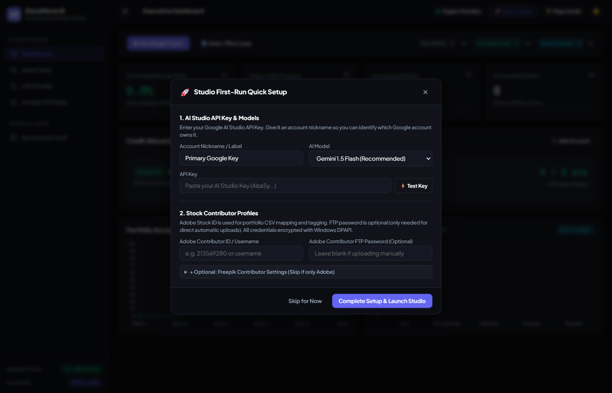
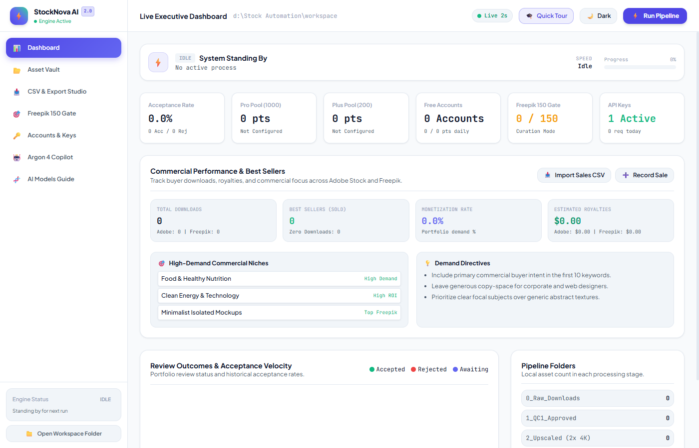
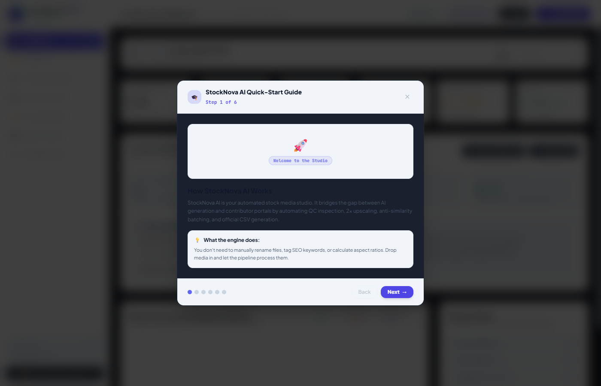
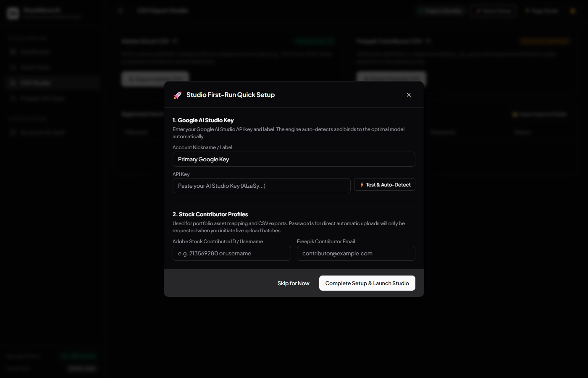

# StockNova AI — Autonomous Stock Photography & Video AI Studio

[](https://www.python.org/downloads/)
[](https://microsoft.com)
[](https://developer.microsoft.com/en-us/microsoft-edge/webview2/)
[](https://tailwindcss.com/)
[](stockpilot/core/security.py)
[](LICENSE)

An executive-grade autonomous pipeline and native Windows desktop studio engineered for end-to-end stock media ingestion, two-stage quality control, 2x AI upscaling, anti-similarity batch distribution, and multi-platform publishing (Adobe Stock & Freepik).

---

## 📸 Visual Showcase

| Dark Mode Dashboard | Light Mode Dashboard |
| :---: | :---: |
|  |  |

| Interactive Quick Tour & Learning Wizard | CSV Export Studio (Adobe 1-21 & Freepik) |
| :---: | :---: |
|  |  |

---

## ⚡ Key Highlights

- **Native WebView2 Executive Dashboard:** Zero-browser-tab native desktop app with pure English typography, instant **Light Mode / Dark Mode** toggle, and flicker-free real-time telemetry.
- **Interactive Quick-Start Guide (`🎓 Quick Tour`):** Built-in 6-step guided walkthrough for first-time users explaining API key setup, media placement, quality control thresholds, and CSV export.
- **Zero-Leak Hardware-Bound Encryption Vault (DPAPI / AES-256):** All contributor passwords, API keys, and browser account identities are encrypted locally using Windows hardware/user-bound DPAPI (`CryptProtectData`) and stored in the local SQLite database. **Zero credentials or accounts are ever committed to Git or pushed to GitHub.**
- **Two-Stage Intelligent Quality Control:**
  - **Stage 1 (Pre-Upscale):** Fast RAM compression and AI visual sanity check (rejects hallucinations, warped artifacts, and deformities).
  - **Stage 2 (Post-Upscale):** 100% full-resolution crop analysis checking OpenCV Laplacian sharpness and digital noise thresholds.
- **Strict 2x AI Upscale Standard:** Locked to 2x magnification (~17 Megapixels, $4096 \times 4096$ or $5500 \times 3000$) using Upscayl CLI, guaranteeing optimal commercial 4K quality without excessive file bloat.
- **Anti-Similarity Batch Distribution (pHash):** Distributes visually related images into separate submission batches via perceptual hashing (pHash distance $> 12$) to eliminate commercial duplicate rejections.
- **Multi-Platform Metadata & CSV Studio:**
  - **Adobe Stock:** Comma-separated (`,`), 5 standard columns (`Filename,Title,Keywords,Category,Releases`), and official **numeric category IDs (1 to 21)**.
  - **Freepik Contributor:** Semicolon-separated (`;`), 5 AI columns (`File name;Title;Keywords;Prompt;Model`), automatic `_ai_generated` tag injection, and strict photo-only filtering.
- **Commercial Downloads & Sales Tracking:** Ingests contributor CSV reports to track best sellers, royalties, and buyer demand trends.
- **Live Ops Center:** Real-time upload speed, active file tracking, and animated progress monitoring.

---

## 📁 Repository Structure

```text
Stock-Nova/
├── config/
│   ├── settings.example.yaml          # Template configuration file
│   ├── accounts_config.example.json   # Template accounts rotation file
│   └── api_keys.example.yaml          # Template API keys file
├── stockpilot/
│   ├── app.py                         # Master pipeline orchestrator
│   ├── core/
│   │   ├── config.py                  # Dynamic configuration loader
│   │   ├── database.py                # Local SQLite persistence engine
│   │   ├── security.py                # DPAPI / AES-256 local encryption vault
│   │   ├── status_monitor.py          # Real-time telemetry provider
│   │   └── browser_account_resolver.py# Chrome/Edge profile resolver
│   ├── metadata/
│   │   ├── category_classifier.py     # Adobe Stock numeric category (1-21) classifier
│   │   ├── batch_exporter.py          # Strict CSV format generator (Adobe & Freepik)
│   │   └── seo_generator.py           # Commercial title and keyword engine
│   ├── platforms/
│   │   ├── adobe_stock.py             # Adobe Stock FTP and validation handler
│   │   └── freepik_curator.py         # Freepik 150 Golden Asset gatekeeper
│   ├── quality/
│   │   ├── stage1_qc.py               # Pre-upscale visual sanity checker
│   │   ├── stage2_qc.py               # Post-upscale 100% crop sharpness validator
│   │   ├── upscaler.py                # Strict 2x Upscayl CLI integration
│   │   └── api_key_rotator.py         # Multi-key HTTP 429 automatic failover
│   └── ui/
│       ├── app.html                   # Modern dark/light responsive interface
│       └── desktop_api.py             # Native pywebview Python-to-JS bridge
├── screenshots/                       # High-resolution application screenshots
├── tools/
│   ├── benchmark_upscayl.py           # Model benchmark script
│   ├── capture_screenshots.py         # Automated UI screenshot generator
│   └── exiftool.exe                   # Standalone IPTC metadata writer
├── workspace/                         # Clean pipeline staging directories (.gitkeep)
│   ├── 0_Raw_Downloads/
│   ├── 1_QC1_Approved/
│   ├── 2_Upscaled/
│   ├── 2_QC2_Approved/
│   ├── 3_Batched_Ready/
│   ├── 4_Uploaded_Awaiting_Submit/
│   └── exports/
├── run.bat                            # 1-Click native Windows desktop launcher
├── requirements.txt                   # Production Python dependencies
└── README.md
```

---

## 🚀 Getting Started

### Prerequisites
1. **Windows 10 or 11 (64-bit)**
2. **Python 3.11+** installed and added to `PATH`
3. **Microsoft Edge WebView2 Runtime** (pre-installed on Windows 10/11)
4. **Upscayl CLI** installed at `C:\Program Files\Upscayl\resources\bin\upscayl-bin.exe`

### Installation
1. Clone the repository:
   ```bash
   git clone https://github.com/SherifOthman/Stock-Nova.git
   cd Stock-Nova
   ```

2. Install Python dependencies:
   ```bash
   pip install -r requirements.txt
   ```

3. Launch the Studio:
   - Double-click `run.bat`, or execute:
   ```bash
   python -m stockpilot.desktop_app
   ```

---

## 🔒 Zero-Leak Security & Privacy Architecture

StockNova is built from the ground up for strict confidentiality:
- **Local SQLite Vault:** All personal tokens, API keys, and contributor passwords are encrypted using **Windows DPAPI** (`CryptProtectData`) and AES-256 before being written to the local database at `data/google_dots.db`.
- **Zero Git Leakage:** All files containing personal configuration or credentials (`config/accounts_config.json`, `config/api_keys.yaml`, `data/*.db`, `data/*.key`) are permanently ignored in `.gitignore`.
- **Masked UI Exposure:** The frontend interface never receives raw secrets; API keys and passwords are masked (`••••••••`) before crossing the WebView2 bridge.

---

## 📊 Platform Metadata Specifications

| Specification | Adobe Stock Contributor | Freepik Contributor |
| :--- | :--- | :--- |
| **Delimiter** | Comma (`,`) | Semicolon (`;`) |
| **Header Row** | `Filename,Title,Keywords,Category,Releases` | `File name;Title;Keywords;Prompt;Model` |
| **Category Format** | **Numeric ID (1 to 21)** strictly | Dynamic keyword taxonomy & asset type |
| **AI Tagging** | Standard IPTC metadata | Mandatory `_ai_generated` in keywords |
| **Supported Media** | Images and Videos | Photos Only (Videos strictly blocked) |

---

## 📜 License

This project is licensed under the [MIT License](LICENSE).
